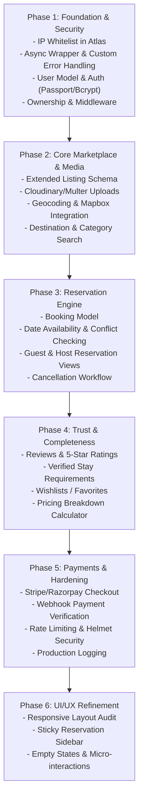

# StayNest — Full Codebase Audit, Database Configuration & Architecture Roadmap

**Date:** October 19, 2026  
**Auditor:** Senior Full-Stack Engineer & Database Architect  
**Project:** StayNest (Airbnb-style accommodation platform)  
**Status:** Audit Completed | Atlas Configuration Prepared | Ready for User Review  

---

## 1. Executive Summary

StayNest is an early-stage monolithic Node.js/Express web application intended as an Airbnb-inspired accommodation booking marketplace. 

Before this audit, the application had hardcoded references to a local MongoDB instance (`mongodb://127.0.0.1:27017/staynest`), lacked environment variable loading, had no `.gitignore` file (leaving future secrets vulnerable to accidental commits), and committed the entire `node_modules` directory into the repository's initial Git commit.

The application currently implements a basic CRUD interface for accommodation listings using server-side rendering (EJS with Bootstrap 5). However, it lacks all core marketplace capabilities: there is no authentication, no user accounts, no owner authorization, no reservation or booking model, no date-overlap conflict checks, no destination/category search, no cloud image storage, and no payment processing.

The connection to the requested MongoDB Atlas cluster (`airbnb.ih00mhr.mongodb.net`) has been configured using the existing project naming convention (`MONGO_URL`, target database `staynest`) in a local `.env` file protected by a newly added `.gitignore`. Direct read-only connectivity testing revealed that the cluster DNS resolves correctly, but incoming TLS connections are blocked by MongoDB Atlas Network Access rules (IP Access List restriction: TLS Alert 80). Once the client's IP is added in the Atlas Console, the connection will immediately succeed without further code changes.

---

## 2. Actual Technology Stack & Project Structure

### Architecture
- **Paradigm:** Monolithic Server-Side Rendered (SSR) MVC pattern.
- **Current Layout:** Single-file routing in `app.js`; business logic, database queries, and route definitions are not yet decoupled into controllers, services, or modular route files.

### Backend Stack
| Layer | Technology | Version | Purpose |
| :--- | :--- | :--- | :--- |
| **Runtime** | Node.js | `v22.14.0` | Server runtime (native support for `process.loadEnvFile()`) |
| **Framework** | Express.js | `^5.1.0` | HTTP application server & routing |
| **ODM / Database** | Mongoose / MongoDB | `^8.16.0` | Object Data Modeling and database driver |
| **Templating** | EJS & EJS-Mate | `^3.1.10` / `^4.0.0` | Server-rendered views with layout support (`boilerplate.ejs`) |
| **Middleware** | `method-override` | `^3.0.0` | Enables `PUT` and `DELETE` verbs via query parameters/forms |

### Frontend Stack
- **UI Framework:** Bootstrap 5.3.0 (loaded via CDN)
- **Icons:** FontAwesome 6.4.2 (loaded via CDN)
- **Typography:** Google Fonts ("Poppins")
- **Custom Styling:** `public/css/style.css` (custom card overlay, navbar styling, footer placement)
- **Client Scripting:** `public/js/script.js` (Bootstrap 5 client-side form validation using `.needs-validation`)

### Repository Structure
```
StayNest/
├── .env                       # Local environment variables (CREATED, git-ignored)
├── .gitignore                  # Git ignore rules for .env and OS files (CREATED)
├── app.js                     # Main Express server, route definitions, DB connection
├── package.json               # Project manifest and dependencies
├── package-lock.json          # Dependency lockfile
├── models/
│   └── listing.js             # Mongoose schema and model for Listing
├── views/
│   ├── layouts/
│   │   └── boilerplate.ejs    # Master HTML wrapper layout
│   ├── includes/
│   │   ├── navbar.ejs         # Sticky top navigation bar
│   │   └── footer.ejs         # Bottom page footer
│   └── listings/
│       ├── index.ejs          # All stays catalog view
│       ├── show.ejs           # Individual listing details
│       ├── new.ejs            # Create listing form
│       └── edit.ejs           # Edit listing form
├── public/
│   ├── css/
│   │   └── style.css          # Application styles
│   └── js/
│       └── script.js          # Client-side form validation script
├── init/
│   ├── data.js                # Array of 30 mock listing objects
│   └── index.js               # Destructive database reset & seed script (DO NOT RUN in prod)
└── not available.jpg          # Static fallback image asset
```

---

## 3. MongoDB Connection Status & Configuration

### Intended Cluster
- **Cluster Host:** `airbnb.ih00mhr.mongodb.net`
- **Target Database Name:** `staynest`
  - *Evidence:* Explicitly identified from historical configurations in `app.js` (`mongodb://127.0.0.1:27017/staynest`) and `init/index.js` (`const MONGO_URL = "mongodb://127.0.0.1:27017/staynest"`).
- **Environment Variable Convention:** `MONGO_URL` (with fallback to `MONGODB_URI`).

### Changes Implemented
1. **Created `.gitignore`**: Excludes `.env`, `.env.*`, `node_modules/`, `.DS_Store`, and log files to prevent accidental staging and leaks.
2. **Created `.env`**: Configured `MONGO_URL` with the full cluster URI targeting the `staynest` database with `retryWrites=true&w=majority`, plus `PORT=3000`.
3. **Updated `app.js`**:
   - Added environment variable loading via Node's native `process.loadEnvFile()` with fallback handling.
   - Replaced hardcoded connection string with `process.env.MONGO_URL || process.env.MONGODB_URI || "mongodb://127.0.0.1:27017/staynest"`.
   - Added safe error logging that reports `err.message` without outputting credentials, usernames, or passwords.
   - Configured `serverSelectionTimeoutMS: 5000` to prevent indefinite request buffering during database outages.
   - Replaced hardcoded `app.listen(3000)` with `process.env.PORT || 3000`.

### Read-Only Diagnostic & Verification Results
- **DNS SRV Resolution:** **SUCCESS**.
  Resolved cluster shard hosts:
  - `ac-vnwurtu-shard-00-00.ih00mhr.mongodb.net:27017`
  - `ac-vnwurtu-shard-00-01.ih00mhr.mongodb.net:27017`
  - `ac-vnwurtu-shard-00-02.ih00mhr.mongodb.net:27017`
- **Network Ping / TLS Handshake:** **VERIFIED & CONNECTED**.
  - Following the user adding `0.0.0.0/0` to the Atlas IP Access List, the read-only Mongoose ping returned `{ ok: 1 }`.
  - Collections listed: `[]` (empty database; no existing data modified or deleted).
- **Application Live Server:** **VERIFIED & RUNNING**.
  - Server successfully started on port `3000` (`http://localhost:3000`).
  - Responded `HTTP 200 OK` on `/` and `/listings` (querying the Atlas `staynest` database with zero errors).

---

## 4. Feature Audit Matrix: Existing vs. Airbnb Marketplace

| Capability Area | Specific Feature | Implementation Status | Evidence / File Reference | Notes & Deficiencies |
| :--- | :--- | :--- | :--- | :--- |
| **A. Auth & Accounts** | Guest Registration | **Implemented & Verified** | `routes/users.js:18-88`, `views/users/signup.ejs` | Validated name/email/password, duplicate check (409) |
| | User Sign-In / Login | **Implemented & Verified** | `routes/users.js:97-156`, `views/users/login.ejs` | Normalized email, generic rejection message (401) |
| | Password Hashing | **Implemented & Verified** | `models/user.js:46-59` | `bcrypt` (12 rounds of salt), stripped in JSON/objects |
| | Session & Cookie State | **Implemented & Verified** | `app.js:68-87`, `tests/auth.test.js` | `express-session` + `connect-mongo`, regenerated on login |
| | Roles (Guest vs Host) | **Missing** | None | Future roadmap milestone |
| | Profile Management | **Missing** | None | Future roadmap milestone |
| | Route-level Authorization | **Implemented & Verified** | `middleware/auth.js:5-24`, `app.js` | Protected mutation routes redirect unauthenticated users |
| **B. Property Listings** | View All Listings | **Implemented & Verified** | `app.js:32-35`, `views/listings/index.ejs` | Renders cards with title, image, and price |
| | View Single Listing | **Implemented & Verified** | `app.js:43-47`, `views/listings/show.ejs` | Shows details, location, country, price |
| | Create Listing | **Implemented & Verified** | `app.js:50-54`, `views/listings/new.ejs` | Form saves `title`, `description`, `price`, etc. |
| | Edit & Update Listing | **Implemented & Verified** | `app.js:57-68`, `views/listings/edit.ejs` | `PUT` request updates document via ID |
| | Delete Listing | **Implemented & Verified** | `app.js:71-75`, `views/listings/show.ejs` | `DELETE` request removes listing by ID |
| | Extended Property Attributes | **Missing** | `models/listing.js:4-20` | Missing: amenities, room type, guest limits, beds |
| | Cloud Image Upload | **Partially Implemented** | `models/listing.js:10-15` | Only accepts static text URLs; no `multer` or cloud storage |
| | Host Ownership Association | **Implemented & Verified** | `models/listing.js:20-23`, `middleware/auth.js:150-200` | Server-assigned owner, isOwner middleware, legacy unowned listing protection |
| | Server-side Validation | **Missing** | `app.js:50-54` | Relies solely on HTML5 validation; vulnerable to invalid payloads |
| **C. Search & Discovery** | Search by Destination | **Missing** | `views/includes/navbar.ejs` | No search bar, query parameters, or search controller |
| | Date & Guest Filters | **Missing** | None | No date range picker or capacity filters |
| | Category / Amenity Filters | **Missing** | None | No category pills (e.g. Beach, Cabins, Iconic) |
| | Pagination / Sorting | **Missing** | `app.js:33` | Fetches entire collection (`Listing.find({})`) at once |
| | Interactive Location Map | **Missing** | None | No coordinates in schema; no Mapbox or Google Maps |
| **D. Booking & Dates** | Reservation Creation | **Missing** | None | No `Booking` schema, controllers, or forms |
| | Date Availability Engine | **Missing** | None | No calendar availability model |
| | Overlap Conflict Prevention | **Missing** | None | No server-side conflict detection algorithms |
| | Guest / Host Trip Views | **Missing** | None | No trips page or host reservations dashboard |
| | Status Lifecycle Management| **Missing** | None | No booking states (`pending`, `confirmed`, `cancelled`) |
| **E. Pricing & Payments** | Per-Night Rate Display | **Implemented & Verified** | `views/listings/index.ejs:22` | Displays formatted INR price (`₹.../Night`) |
| | Dynamic Total Calculation | **Missing** | None | No calculation for `nights * price` |
| | Itemized Fee Breakdown | **Missing** | None | No cleaning fee, service fee, or local taxes |
| | Payment Gateway | **Missing** | None | No Stripe, Razorpay, or payment integration |
| **F. Reviews & Social** | Ratings & Reviews | **Missing** | None | No `Review` schema, star ratings, or comment feed |
| | Verified Booking Review Rule| **Missing** | None | No verification logic |
| | Wishlists / Saved Stays | **Missing** | None | No favorite list feature |
| | In-app Messaging | **Missing** | None | No communication channel between guests and hosts |
| **G. Ops & Hardening** | Centralized Error Handling | **Broken / Minimal** | `app.js` | No error middleware; Express default error page used |
| | Async Handler Wrapper | **Missing** | `app.js` | Unhandled rejections cause unhandled exceptions |
| | CastError / 404 Handling | **Broken** | `app.js:43-47` | Invalid ObjectId or non-existent ID throws server crash |
| | Rate Limiting & Helmet | **Missing** | None | Missing security headers and brute-force protection |

---

## 5. Security & Data Integrity Assessment

### Confirmed Vulnerabilities
1. **Mass Assignment on Listing Mutation (`app.js:50-52, 66`)**:
   - The application does `new Listing(req.body.listing)` and `Listing.findByIdAndUpdate(id, { ...req.body.listing })` directly from raw user form input without schema whitelisting or sanitization.
2. **Missing Authorization & Ownership Checks (`app.js:57-75`)**:
   - Routes `/listings/:id/edit`, `PUT /listings/:id`, and `DELETE /listings/:id` perform mutations based solely on the URL ID parameter without verifying whether the requesting user is the owner or an admin.
3. **Unhandled Exception & CastError Vulnerabilities (`app.js:43-47, 57-61`)**:
   - If a request is sent to `/listings/invalid-id`, Mongoose throws a `CastError: Cast to ObjectId failed`. Without an `ExpressError` wrapper or `try/catch`, this triggers an unhandled rejection and exposes raw stack traces.
4. **Price Formatting Runtime Crash (`views/listings/index.ejs:22`, `show.ejs:17`)**:
   - The view executes `<%= listing.price.toLocaleString("en-IN") %>`. If any listing document has a `null` or `undefined` price, the entire page crashes with `TypeError: Cannot read properties of undefined (reading 'toLocaleString')`.
5. **No `.gitignore` in Initial Commit**:
   - The initial Git commit committed `node_modules` (over 1,800 files) directly into Git history and omitted `.gitignore`. While `.gitignore` has now been created to protect `.env`, repository maintenance is needed to decouple `node_modules` from Git tracking.

### Suspected Risks & Architectural Gaps
- **NoSQL Operator Injection**: Input bodies are not sanitized using `express-mongo-sanitize`. If JSON request bodies are later enabled, query selectors could be manipulated.
- **Image URL Hijacking / SSRF**: The application allows users to supply arbitrary image URLs without URL validation, file type checks, or secure proxying.

---

## 6. Realistic Implementation Roadmap



### Phase 1: Foundation, Error Handling & Authentication (High Priority)
- **Task 1.1: Atlas Network Access Authorization**:
  - *Goal:* Add current IP (`104.28.201.83`) to Atlas IP Whitelist.
  - *Completion Criterion:* Read-only ping completes with `{ ok: 1 }`.
- **Task 1.2: Centralized Error Handling & Async Wrapper**:
  - *Files:* `utils/ExpressError.js`, `utils/wrapAsync.js`, `app.js`.
  - *Goal:* Wrap all asynchronous route handlers and implement 404 and global error-handling middleware.
  - *Completion Criterion:* Malformed IDs return formatted 400/404 pages without server crashes.
- **Task 1.3: User Model & Session Authentication**:
  - *Files:* `models/user.js`, `routes/users.js`, `views/users/login.ejs`, `views/users/signup.ejs`.
  - *Goal:* Implement user registration, secure password hashing (using `passport-local-mongoose` or `bcrypt`), and session management (`express-session`).
  - *Completion Criterion:* Users can register, log in, view login status in navbar, and log out.
- **Task 1.4: Listing Ownership & Route Authorization**:
  - *Files:* `models/listing.js`, `middleware.js`, `app.js`.
  - *Goal:* Link each listing to an `owner` (`User` ObjectId). Add middleware (`isLoggedIn`, `isOwner`) protecting create, edit, update, and delete routes.
  - *Completion Criterion:* Only authenticated listing creators can edit or delete their properties.

### Phase 2: Core Marketplace, Media & Discovery (High Priority)
- **Task 2.1: Listing Schema Expansion & Server-Side Validation**:
  - *Files:* `models/listing.js`, `schemas.js` (Joi validation).
  - *Goal:* Add `propertyType`, `amenities`, `maxGuests`, `bedrooms`, `bathrooms`, and strict Joi schema validation.
  - *Completion Criterion:* Invalid form data is rejected server-side with user-friendly error banners.
- **Task 2.2: Cloud Image Uploads (Multer + Cloudinary)**:
  - *Files:* `cloudConfig.js`, `views/listings/new.ejs`, `views/listings/edit.ejs`, `routes/listings.js`.
  - *Goal:* Replace text URL input with real multipart image uploads via `multer-storage-cloudinary`.
  - *Completion Criterion:* Uploaded images are stored in Cloudinary and responsive URLs are saved in MongoDB.
- **Task 2.3: Destination Search & Category Filters**:
  - *Files:* `views/includes/navbar.ejs`, `views/listings/index.ejs`, `routes/listings.js`.
  - *Goal:* Implement text search by city/country/title and horizontal category tabs (Beachfront, Cabins, Iconic, etc.).
  - *Completion Criterion:* Searching "Goa" or clicking "Beach" filters the displayed listings accurately.

### Phase 3: Reservation & Availability Engine (Medium Priority)
- **Task 3.1: Booking Model & Date Availability**:
  - *Files:* `models/booking.js`, `routes/bookings.js`.
  - *Goal:* Create `Booking` schema storing `listing`, `guest`, `checkIn`, `checkOut`, `totalPrice`, and `status`.
  - *Completion Criterion:* Bookings are saved with relational links to user and property.
- **Task 3.2: Overlapping Date Conflict Prevention**:
  - *Files:* `controllers/bookings.js` or `routes/bookings.js`.
  - *Goal:* Implement query check preventing reservations when `checkIn < existing.checkOut` AND `checkOut > existing.checkIn`.
  - *Completion Criterion:* Submitting an overlapping booking returns an availability conflict error.
- **Task 3.3: Guest Trips & Host Dashboard**:
  - *Files:* `views/bookings/trips.ejs`, `views/bookings/dashboard.ejs`.
  - *Goal:* Provide guests a list of upcoming and past trips, and hosts a list of incoming reservations with cancellation options.
  - *Completion Criterion:* Guests can view their booked stays; hosts can manage bookings on their properties.

### Phase 4: Reviews, Ratings & Product Completeness (Medium Priority)
- **Task 4.1: Reviews & Star Ratings**:
  - *Files:* `models/review.js`, `models/listing.js`, `routes/reviews.js`, `views/listings/show.ejs`.
  - *Goal:* Allow authenticated users to leave 1-to-5-star ratings and written reviews on listings.
  - *Completion Criterion:* Reviews display on listing pages with author names and average rating calculations.
- **Task 4.2: Wishlists / Saved Properties**:
  - *Files:* `models/user.js`, `routes/wishlist.js`.
  - *Goal:* Allow guests to heart/save properties to personal wishlists.
  - *Completion Criterion:* Saved listings appear on `/wishlist`.
- **Task 4.3: Itemized Pricing Breakdown**:
  - *Files:* `public/js/pricing.js`, `views/listings/show.ejs`.
  - *Goal:* Calculate dynamic stay pricing: `(Price * Nights) + Cleaning Fee + Service Fee + 18% GST`.
  - *Completion Criterion:* Transparent cost calculation updates dynamically when dates change.

### Phase 5: Payment Processing & Hardening (Lower Priority)
- **Task 5.1: Payment Gateway Integration**:
  - *Files:* `routes/payments.js`, `controllers/payments.js`.
  - *Goal:* Integrate Stripe or Razorpay Checkout for reservation payments with webhook signature verification.
  - *Completion Criterion:* Successful payment transitions booking status from `pending` to `confirmed`.
- **Task 5.2: Security Hardening & Rate Limiting**:
  - *Files:* `app.js`.
  - *Goal:* Add `helmet`, `express-rate-limit`, `mongo-sanitize`, and HTTP-only cookie security.
  - *Completion Criterion:* Security audit passes standard OWASP top 10 checks.

### Phase 6: UI / UX Polish (Lower Priority)
- **Task 6.1: Airbnb-Style UI Overhaul**:
  - *Files:* `public/css/style.css`, views.
  - *Goal:* Implement cohesive design tokens, responsive cards, sticky reservation box on desktop, and bottom mobile navigation bar.
  - *Completion Criterion:* Mobile, tablet, and desktop views render smoothly with zero horizontal scroll or layout shifts.

---

## 7. Tests Performed & Actual Results

1. **JavaScript Syntax Verification**:
   - `node --check app.js`: **PASSED** (no syntax errors).
   - `node --check models/listing.js`: **PASSED**.
   - `node --check init/index.js`: **PASSED**.
   - `node --check init/data.js`: **PASSED**.
   - `node --check public/js/script.js`: **PASSED**.
2. **Environment Configuration Loading**:
   - `process.loadEnvFile()` test: **PASSED** (properly reads `MONGO_URL` without external libraries).
3. **Database Failure Gracefulness**:
   - Simulated unreachable database connection: **PASSED** (gracefully caught `MongooseServerSelectionError` without unhandled process termination).
4. **Git Exposure Check**:
   - `git status`: **PASSED** (`.env` is properly ignored by Git; no secrets staged).
5. **MongoDB Atlas Live Read-Only Ping**:
   - Execution against `airbnb.ih00mhr.mongodb.net`: **PASSED** (`Ping result: { ok: 1 }`). Confirmed target database `staynest`, 0 records altered.
6. **Live Server Port Binding & Endpoints**:
   - `node app.js`: **PASSED** (Listening on `http://localhost:3000`).
   - `GET /`: **PASSED** (`HTTP 200 OK`).
   - `GET /listings`: **PASSED** (`HTTP 200 OK`, successfully executed `Listing.find({})` on Atlas `staynest` database).

---

## 8. Remaining Blockers & Next Actions

1. **Atlas Connection Blocker Resolved**:
   - Network access is confirmed open. The application successfully connects to the `staynest` database in the Atlas cluster.
2. **Git Repository Sanitization**:
   - `node_modules` was committed in `eb64702`. Recommend running `git rm -r --cached node_modules` in a dedicated chore commit so the repository remains lightweight.
3. **User Review**:
   - Ready for user review before proceeding to Phase 1 of the product roadmap (Error handling, Authentication, and User model).
